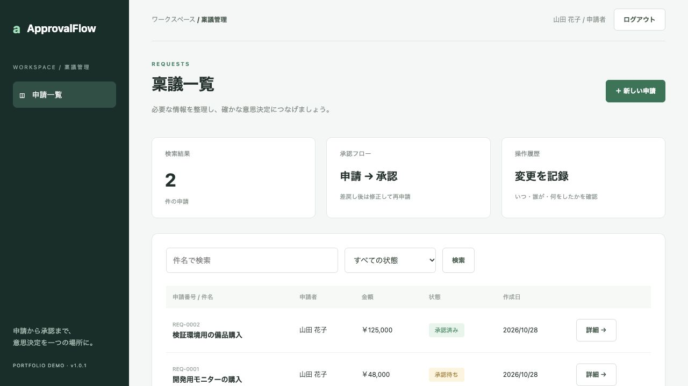

# ApprovalFlow — 稟議申請・承認管理

C# / ASP.NET Core / Entity Framework Core / SQL Server による業務Webアプリの自主制作作品です。購入申請を下書きから承認まで管理し、差戻し・修正・再申請と操作履歴を扱います。

## 確認できること

- Cookie認証、申請者と承認者の権限分離、申請者本人だけに限定した参照・編集
- 金額・件名・理由の検証、状態遷移、検索・状態絞り込み・20件単位のページング
- バージョン付き条件更新による古い編集と二重承認の防止（HTTP 409で通知）
- 申請の更新と操作履歴を同一トランザクションで保存
- EF Coreによる非同期データアクセス、LINQ、DI、SQL Serverの外部キー・CHECK制約・インデックス
- CSRF対策、パスワードハッシュ、ログイン試行回数制限、CSP、HttpOnly / SameSite Cookie
- 実SQL Serverを使うHTTP統合テスト、依存ライブラリ監査、GitHub Actions用CI定義

## 画面

ログイン後、申請一覧から詳細と履歴を確認します。申請者は下書きを保存して申請、承認者は承認または理由を付けて差戻しできます。



## 最短の起動方法

Docker Desktop（Linuxコンテナ）とComposeを使用します。アプリ用の.NET SDKのホストインストールは不要です。SQL Server用に少なくとも2GB、全体で6〜8GB程度のDockerメモリを推奨します。

```sh
cp .env.example .env
# .env内の2つのパスワードを変更する（DEMO_PASSWORDは12文字以上）
docker compose up --build -d
```

DB_PASSWORDは大文字・小文字・数字・記号を含む16文字以上を推奨します。このデモの接続文字列形式では、英数字と `!_-` を使い、セミコロン・引用符・ドル記号・空白を避けてください。

ブラウザーで http://localhost:8790 を開きます。初回はSQL Serverの起動に時間がかかります。

| 用途 | メールアドレス | パスワード |
|---|---|---|
| 申請者 | requester@example.test | .envのDEMO_PASSWORD |
| 承認者 | approver@example.test | .envのDEMO_PASSWORD |
| 別の申請者 | other@example.test | .envのDEMO_PASSWORD |

停止は `docker compose down`。データは名前付きボリュームに保存します。パスワード変更は既存アカウントに自動反映されません。データが不要なローカルデモだけ、`docker compose down -v` で全データを削除して初期化できます。

SQL Server 2022 Developer Editionを開発・試験用途で利用します。Apple Siliconではamd64エミュレーションによる起動を検証しましたが、Microsoftの正式なサポート対象はLinux x86-64です。商用環境では対応するライセンス・実行環境を選定してください。[公式のプラットフォーム条件](https://learn.microsoft.com/en-us/sql/linux/install-upgrade/quickstart-install-docker?view=sql-server-ver17)

## 5分で試す

1. 申請者でログインし「新しい申請」を開く。件名、金額、目的を入れて保存する。
2. 「申請する」を押す。承認待ちになり、編集できなくなる。
3. ログアウト後、承認者でログインして対象の申請を開く。
4. 理由を入力して「差し戻す」。申請者で修正・保存・再申請する。
5. 承認者で承認し、履歴に各操作・担当者・時刻が記録されることを確認する。
6. 同じ申請を2画面で開き、片方で更新する。古い画面からの更新は競合として拒否される。
7. 別の申請者でログインし、他者の申請が表示されないことを確認する。

## 開発・試験

.NET SDK 10.0.403。EF Core等の直接参照バージョンと推移依存はcsproj / packages.lock.jsonに保存しています。

```sh
# ローカルSDKで実行する場合。専用の試験用SQL Serverへの接続文字列を指定する。
export TEST_DATABASE='Server=localhost,1433;User Id=sa;Password=YOUR_TEST_PASSWORD;TrustServerCertificate=True'
dotnet restore tests/ApprovalFlow.Tests --locked-mode
dotnet test tests/ApprovalFlow.Tests -c Release --no-restore
dotnet format src/ApprovalFlow/ApprovalFlow.csproj --verify-no-changes --no-restore
dotnet format tests/ApprovalFlow.Tests/ApprovalFlow.Tests.csproj --verify-no-changes --no-restore
dotnet list tests/ApprovalFlow.Tests package --vulnerable --include-transitive
```

ComposeのDBはホストにポートを公開しません。Docker経由の再現試験は [検証手順](docs/TESTING.md) を参照してください。テストは `ApprovalFlowTest_` にランダムな識別子を付けた専用DBを作成します。業務データのある接続先は使用しないでください。

## 資料

- [C#案件調査と要件対応表](docs/RESEARCH.md)
- [設計・業務ルール・API](docs/DESIGN.md)
- [テスト手順](docs/TESTING.md)
- [検証結果](docs/VALIDATION.md)
- [反証指摘への対応と一次再審査](docs/REVIEW_RESPONSE.md)
- [運用とAzureへの展開検討](docs/OPERATIONS.md)
- [レビューを依頼する際の指示](docs/COUNTER_REVIEW.md)

## 範囲と位置付け

基本設計・詳細設計・実装・検証を説明するための自主制作です。C#実務経験年数、受託納品、本番運用、第三者認証を示すものではありません。Azureへの実デプロイ、Entra ID / MFA、メール通知、添付ファイル、多段承認、組織管理、会計処理は未実装です。案件すべての必須条件を満たすと主張するものではありません。

ローカルデモのComposeはDevelopment環境でデータベースを自動初期化し、共通パスワードの試用アカウントを作成します。本番公開用設定ではありません。運用上の追加対応はOPERATIONS.mdに整理しています。

作品固有のライセンスは未指定です。依存ライブラリはそれぞれのライセンスに従います。

## v1.0.1の修正

時刻JSONをZ付きUTCに統一し、日本時間で9時間ずれる問題を修正しました。セッション失効後の再ログイン、不正JSONの4xx応答、空Versionの拒否も修正しています。詳細はREVIEW_RESPONSE.mdを参照してください。

一式の再検証は `python3 scripts/verify.py`。生ログ、実行日時、終了コード、実行ごとのTRX、試験DBの残存SQLを別々のファイルで保存します。

## 公開先

https://github.com/no-dev-portfolio/approvalflow-csharp-portfolio

[GitHub Actions](https://github.com/no-dev-portfolio/approvalflow-csharp-portfolio/actions)

公開用コピーでは、検証ログのローカル作業フォルダー名を `/workspace` に置換しています。アプリのソースとテストの内容はv1.0.1の審査版と同一です。
