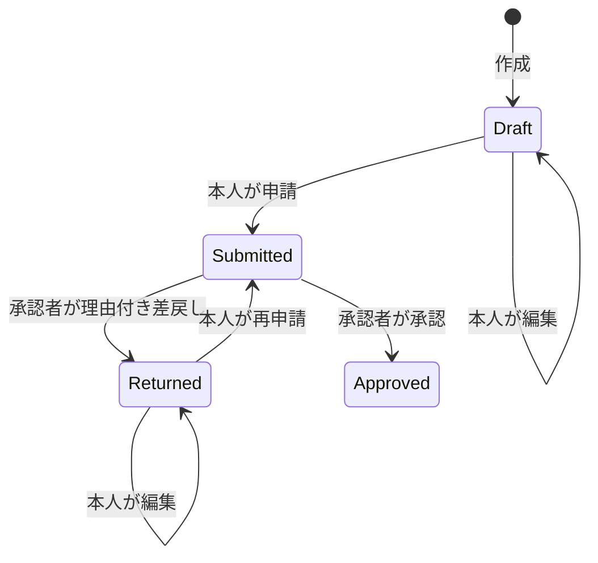

# 設計書

## 利用者と業務

小規模組織の物品購入稟議を想定。単一組織、申請者と承認者の2ロール、金額は整数の日本円（1〜100,000,000円）。税込税抜の計算、会計仕訳、発注、支払は対象外。

申請者は自分の申請だけを参照する。承認者は下書き以外を参照できる。承認者は申請作成・編集不可、申請者は承認・差戻し不可。自分の承認は禁止。サーバー側で判断するため画面のボタン非表示だけに依存しない。

Approvedは終端。取消・削除は未提供。差戻し理由は必須、任意承認コメントとともに500文字まで。件名100文字、目的2000文字まで。件名の制御文字、目的・コメントの改行以外の制御文字は拒否。

## 構成

ブラウザー（HTML/CSS/JavaScript）→ ASP.NET Core Minimal API → Workflow → EF Core → SQL Server。
外部UIライブラリ不要。C#側で認証認可・入力検証・状態遷移を行う。データ層はDbContext、ルールを伴う更新はWorkflowへ分離。小規模のため不要なリポジトリー抽象やCQRSのフレームワークは導入していない。

## テーブル

| テーブル | 主な列 | 制約・用途 |
|---|---|---|
| Users | Id, Email, Name, Role, PasswordHash | Email一意、ハッシュのみ保存 |
| Requests | Id, OwnerId, Title, Purpose, Amount, Status, Version, CreatedAt | Owner外部キー、金額・状態CHECK、検索用複合インデックス |
| Audits | Id, RequestId, ActorId, Action, Comment, At | 申請・利用者外部キー、申請別履歴インデックス |

時刻はUTCで保存し、SQL Serverからの読出し時にEF値変換でDateTimeKind.Utcを復元する。JSONはZ付きUTC。画面ではブラウザーのローカル時刻を表示し、UTC 15:30は日本では翌日00:30になる。Versionは更新ごとに新しいGUID。監査はアプリAPIでは変更不可だが、DB管理者による改変を防ぐ耐改ざんログではない。

## 競合と原子性

読み込んだVersionを更新要求で返す。UPDATEのWHEREにID・Version・更新可能な状態を含め、更新行数0なら409。更新した履歴だけを同一DBトランザクションで保存し、履歴保存が失敗した場合は更新もロールバックする。ExecuteUpdateAsyncは自動で並行性例外を出さないため、明示的な条件と行数判定が必要。

同じ承認要求を再送すると409になる。レスポンスを保存して同じ成功応答を返すIdempotency-Key方式は未実装。申請作成には重複排除キーがないため、応答不明時は一覧で確認してから再送する。

## API

| メソッド | パス | 概要 |
|---|---|---|
| GET | /api/csrf | CSRFトークン発行 |
| POST | /api/login | 認証、IPごとの試行回数制限 |
| POST | /api/logout | Cookie破棄 |
| GET | /api/me | 利用者情報 |
| GET | /api/requests?page=1&status=Submitted&q=購入 | 20件ページングと検索 |
| POST | /api/requests | 下書き作成 |
| GET | /api/requests/{id} | 詳細と操作履歴 |
| PUT | /api/requests/{id} | 本人の下書き・差戻しを修正 |
| POST | /api/requests/{id}/actions | submit / approve / return |
| GET | /health/live | プロセス生存 |
| GET | /health/ready | DB接続確認 |

認証なし401、作成・編集のロール拒否403、対象外・不存在404、入力・CSRF400、不正なメディア型415、競合や不許可の状態遷移409、過剰ログイン429。例外時は一般的な500応答としDB例外の内容をクライアントに公開しない。

RequestInput: `{ "title":"購入", "purpose":"業務用", "amount":48000, "version":"GUID" }`。新規作成のversionは無視される。
更新・状態遷移では空または欠落したVersionを400で拒否。開発モードでもJSONの構文・型・必須本文の不正は4xxとする。状態遷移でのロール違反は409であり、作成・編集の403と区別する。

DecisionInput: `{ "action":"return", "comment":"説明を追加してください", "version":"GUID" }`。
